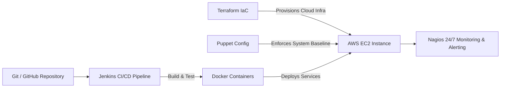

# AI Powered Resume Analyzer: Automated DevOps Lifecycle and Resilient Infrastructure Pipeline

**Course:** INT333  
**Submitted By:** AMAN KUMAR SINGH  
**Registration Number:** 12301704  
**Section:** K202316 | **Roll No:** 2  
**Institution:** Lovely Professional University, Phagwara, Punjab  

---

## 1. Project Overview & Architectural Flow
This project implements an end-to-end automated enterprise DevOps lifecycle for an **AI Powered Resume Analyzer**. The system parses PDF resumes, computes semantic match scores against target job descriptions using Google Gemini LLM, and persists evaluation metrics in MongoDB, all while being continuously delivered and monitored through industry-standard DevOps tools.



### Core DevOps Toolchain:
| Tool | Category | Role in Project |
| :--- | :--- | :--- |
| **Terraform** | Infrastructure as Code (IaC) | Declarative provisioning of AWS VPC, Subnets, Security Groups, and EC2 instances. |
| **Puppet** | Configuration Management | Automates system packages, Docker runtime setup, and Nagios NRPE client baselines. |
| **Docker** | Containerization | Encapsulates React frontend, Node.js API, and MongoDB into isolated containers. |
| **Jenkins** | CI/CD Automation | Orchestrates automated checkout, Jest testing, Docker image building, and deployment. |
| **Nagios** | Health Monitoring | Proactive monitoring of host uptime, system metrics (CPU, RAM, Disk), and HTTP endpoints. |
| **Gemini AI** | LLM Engine | Extracts technical entities, performs semantic scoring, and highlights skill gaps. |

---

## 2. Step-by-Step Execution & Screenshot Guide

### 📸 Screenshot 1: AWS EC2 Instance Launch & SSH Connection
1. Launch an AWS EC2 Free Tier instance (`t2.micro` or `t3.micro`, Ubuntu 22.04 LTS, 20GB-30GB gp3 storage).
2. Configure Security Group with ports: `22` (SSH), `80` (React Web), `5000` (API), `8080` (Jenkins), `8085/80` (Nagios).
3. Connect via SSH:
   ```bash
   ssh -i your-key.pem ubuntu@<EC2-PUBLIC-IP>
   ```
4. **Take Screenshot 1:** Terminal showing active SSH session on EC2.

---

### 📸 Screenshot 2: Terraform Infrastructure as Code (IaC)
1. Navigate to the terraform directory:
   ```bash
   cd terraform
   terraform init
   terraform plan
   ```
2. **Take Screenshot 2:** Terminal showing `terraform plan` with 6+ AWS resources to be provisioned (VPC, Subnet, Route Table, Security Group, EC2 Instance).

---

### 📸 Screenshot 3: Puppet Configuration Enforcement
1. Run Puppet in standalone mode to enforce system baselines:
   ```bash
   sudo puppet apply /home/ubuntu/INT333-PROJECT/puppet/manifests/site.pp
   ```
2. **Take Screenshot 3:** Puppet apply execution output showing successful catalog application and notice messages.

---

### 📸 Screenshot 4: Docker Microservices Containerization
1. Build and launch all services using Docker Compose:
   ```bash
   docker compose up -d --build
   docker compose ps
   ```
2. **Take Screenshot 4:** Output of `docker ps` showing all three containers (`resume_frontend`, `resume_backend`, `resume_mongodb`) in `Up` (healthy) status.

---

### 📸 Screenshot 5: Working AI Resume Analyzer Web Application
1. Open your browser and navigate to:
   ```
   http://<EC2-PUBLIC-IP>
   ```
2. Upload a sample PDF resume or use the pre-filled technical profile.
3. Click **"Analyze Candidate Match with Gemini AI"**.
4. **Take Screenshot 5:** Browser showing the candidate match score gauge (e.g., 88%), extracted technical skills, strengths, missing skills, and Gemini AI recommendations.

---

### 📸 Screenshot 6: Jenkins Automated CI/CD Pipeline
1. Access Jenkins at:
   ```
   http://<EC2-PUBLIC-IP>:8080
   ```
2. Create a Pipeline Job linked to the repository's `Jenkinsfile`.
3. Trigger a build (**Build Now**).
4. **Take Screenshot 6:** Jenkins Pipeline Stage View showing all 5 stages in green:
   - *1. Code Verification & Checkout*
   - *2. Automated Unit Testing*
   - *3. Build Docker Microservices*
   - *4. Automated Container Deployment*
   - *5. Production Health Verification*

---

### 📸 Screenshot 7: Nagios Infrastructure & Application Health Dashboard
1. Access Nagios at:
   ```
   http://<EC2-PUBLIC-IP>/nagios4
   ```
   *(Login with `nagiosadmin` / `admin123`)*
2. Click **"Services"** in the left navigation sidebar.
3. **Take Screenshot 7:** Nagios Services grid showing all services in **OK (Green)** status:
   - `PING Check`
   - `Current Load`
   - `Root Partition Disk Space`
   - `HTTP - React Web Dashboard`
   - `HTTP - Backend REST API`
